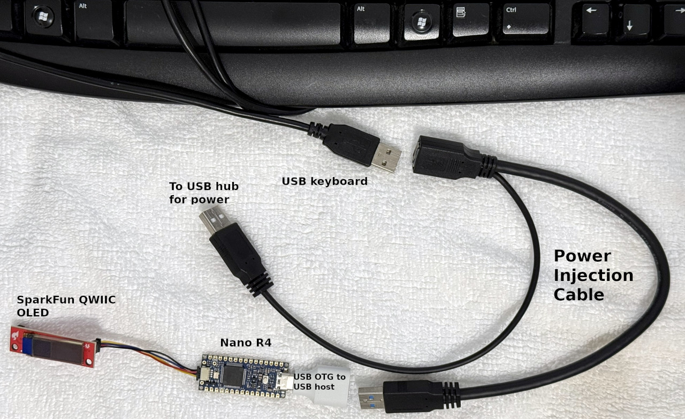

# Nano R4 USB host keyboard

An Arduino Nano R4 acting as a **USB host** for a normal USB keyboard. The raw
eight-byte USB HID report is printed on a SparkFun Qwiic OLED — no parsing into
characters, the report itself.

```
row 1   LC LS LA LG RC RS RA RG     a label appears while that modifier bit is set
row 2   04 1E 00 00 00 00           the six keycodes, two hex digits each, in report order
row 3   kbd ok                      kbd ok = boot keyboard, kbd decl = as declared, no kbd = none
```

Report byte 0 is the modifier bitmap (bit 0 L-Ctrl, bit 1 L-Shift, bit 2 L-Alt,
bit 3 L-GUI, bit 4 R-Ctrl, bit 5 R-Shift, bit 6 R-Alt, bit 7 R-GUI). Byte 1 is
the reserved field. Bytes 2–7 are the six keycodes.

Typing `A` gives `LS` lit in row 1 and `04 00 00 00 00 00` in row 2 — the
keyboard sends the left-shift and the `a` scancode as one report, and the
modifier stays lit until you release the key.

## Hardware

| Item | Notes |
|---|---|
| Arduino Nano R4 | Renesas RA4M1, USB-C connector is the host port |
| SparkFun Qwiic OLED Display, 0.91 in, 128×32 | SSD1306, I²C only — attaches to the Qwiic connector |
| USB OTG cable, Type-C → Type-A host | the keyboard plugs into the Type-A end |
| USB power splitter cable | supplies VBUS to the keyboard's Type-A branch |

The Nano R4 **does not source VBUS from its USB connector**. Self-powered
keyboards work straight off the OTG cable; a bus-powered keyboard needs the
power splitter (or a powered hub) or it never sees a powered bus.

Verified on the bench with a real keyboard and the power splitter: the modifier
row and the six keycode cells both track the report.



"USB power splitter cable" is the search term to find the cable with three USB
connectors but when used here it is more accurately described as an "USB power
injection cable".

The cables are unplugged to make it easier to see the connectors on each cable.
The small white adapter can be found by searching for "usb otg type c male to
type a female cable or adapter". I cannot guarantee every adapter and cable
works.

## Libraries

Both live in `~/Arduino/libraries` and are already installed on this machine.

- **UnoR4-tinyusb** (<https://github.com/controllercustom/UnoR4-tinyusb>) — TinyUSB
  device + host for the RA4M1 RUSB2 port. Installed as the **`unor4tinyusb` board
  package** (`Nano R4 (TinyUSB)`), which is what makes the `tusb_config.h` next to
  this sketch actually take effect.
- **SparkFun Qwiic OLED** — use the fork,
  <https://github.com/controllercustom/SparkFun_Qwiic_OLED_Arduino_Library>, branch
  **`remove_printf`**. Upstream 1.0.14/1.0.15 call `Serial.printf`, which does not
  exist on the Renesas core (`fatal error: 'class _SerialUSB' has no member named
  'printf'`). The fork also drops leftover debug output. It keeps the folder name
  and reports `version=1.0.15`, so the include is unchanged.

## Build

```bash
arduino-cli compile --fqbn unor4tinyusb:renesas_uno:nanor4 .
arduino-cli upload  --fqbn unor4tinyusb:renesas_uno:nanor4 --port 1-1 .
```

Upload goes over **DFU**, never a serial port. `arduino-cli board list` names the port by its USB
topology path (observed `1-1`). Because this is USB *host* firmware, once it runs the board stops
enumerating on the PC altogether — no `2341:0074`, no `/dev/ttyACM0`, nothing in `lsusb` — while
5 V keeps it running and the OLED still displays. So there is no serial port to pass, and **to
flash a second time you must double-tap RESET** to bring the DFU bootloader (`2341:0374`) back.
The core's recipe, `dfu-util --device 0x2341:0x0074,:0x0374 -a0`, accepts the bootloader or the
runtime PID, so either state uploads fine. A successful upload ends with `Download done.` /
`Done!` and then `New upload port: 1-1 (dfu)`.

**If you change `tusb_config.h`, rebuild with `--clean`.** arduino-cli does not treat that file as a
dependency of the core's TinyUSB sources, so a plain rebuild can silently reuse objects compiled
with the old config — and still print a plausible memory report. `arm-none-eabi-nm -S
<sketch>.elf | grep _hidh` shows what actually got built.

Verified sizes: **71,176 B flash (27 % of 262,144) / 10,676 B RAM (32 % of 32,768)**.

## Console (optional)

The board is the host, so the USB CDC `Serial` object is not a console — TinyUSB
owns that port. Debug lines (`mount`, VID:PID, every report) go to **`Serial1`**,
the hardware UART: pin **D0 = RX**, **D1 = TX**, 115200 8N1, 3.3 V. Wire any USB-UART
adapter into those two pins to watch; with nothing attached the sketch still runs
and the OLED still shows everything.

Because host firmware makes the board invisible to the PC (see Build), this UART is
the only window into what the USB stack is doing. A working Holtek
`04d9:1203` composite keypad produces exactly this, and **the order matters** —
`boot protocol set` must come last:

```
[kbd] hid mount dev=1 idx=0 itf=1 desc=62    IF0 is a boot keyboard; desc = report desc length
[kbd] hid mount dev=1 idx=1 itf=0 desc=101   IF1 consumer/system controls; ignored on screen
[kbd] mount dev=1 vid=04D9 pid=1203 ready=1  every interface configured, device ready
[kbd] boot protocol set dev=1 idx=0          canonical 8-byte reports confirmed
[kbd] mod=00 keys=5F 00 00 00 00 00          one line per changed report (5F = KP7)
```

If `boot protocol set` appears *before* the second `hid mount`, the control
transfer was issued too early and derailed the rest of enumeration: the OLED still
reads `kbd ok`, but no report can ever arrive. Lines that mean something is wrong:

```
[kbd] set_protocol FAILED ... staying in report protocol    switch refused -> "kbd decl"
[kbd] receive_report could not arm idx=N                    IN endpoint not claimed -> deaf
[kbd] device-level mount did not complete, starting anyway   an interface stalled enumeration
[kbd] short report len=N                                    not the 8-byte boot report
```

## Troubleshooting

- **OLED blank, sketch running** — the Qwiic connector is `Wire1` (pins 26/27),
  not `Wire` (the A4/A5 pair). `begin()` defaults to `Wire`, so the sketch must
  call `Wire1.begin()` **and** pass it: `myOLED.begin(Wire1)`.
- **Keyboard never mounts** — most often a bus-powered keyboard without the
  power splitter, so it never sees a powered bus. Look for a
  `[kbd] mount dev=... vid=... pid=...` line on the console; no such line means
  the keyboard is not even enumerating. `lsusb` on your computer cannot help
  here: the Nano R4 *is* the host, so nothing downstream of it ever appears on
  your machine's bus.
- **Only the first report shows** — the report callback must re-arm with
  `tuh_hid_receive_report()`; without it the keyboard reports exactly once.
- **`kbd decl` instead of `kbd ok`** — the interface on the display is not in HID
  boot protocol, so the screen shows that interface's own report layout rather
  than the canonical 8-byte keyboard report. Either the keyboard exposes no boot
  interface, or `SET_PROTOCOL` failed — the console says which. The byte layout
  can differ, so rows 1 and 2 need not line up with the modifier/keycode fields.
- **`kbd ok` but row 2 never changes** — check the *order* of console lines (see
  Console). `boot protocol set` printing before every interface has mounted means
  the control transfer was issued from inside the mount callback and derailed the
  rest of enumeration: the follow-on interface never configured, so the
  device-level mount never happened and no report ever arrived. The console shows
  no error at all, and the device *is* configured — a stalled driver pass is
  invisible from the outside.
- **Mounts, but row 2 stays blank or shows nonsense** — composite keyboards
  expose several HID interfaces (vendor/driver, consumer control, sometimes a
  mouse), and TinyUSB claims any of them. The sketch selects the one it reports
  as a boot keyboard instead of assuming index 0, but that needs a slot per
  interface: keep `CFG_TUH_HID` at 4. With a single slot the keyboard interface
  is dropped during enumeration and never mounts.

## Acknowledgments

This sketch was developed with assistance from [OpenCode](https://opencode.ai).

## License

[MIT](./LICENSE) — see the `SPDX-License-Identifier: MIT` header at the top of
each source file.
